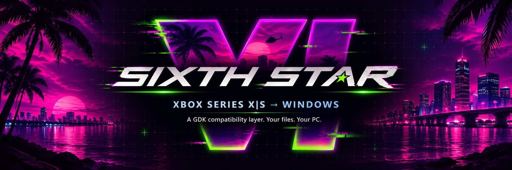
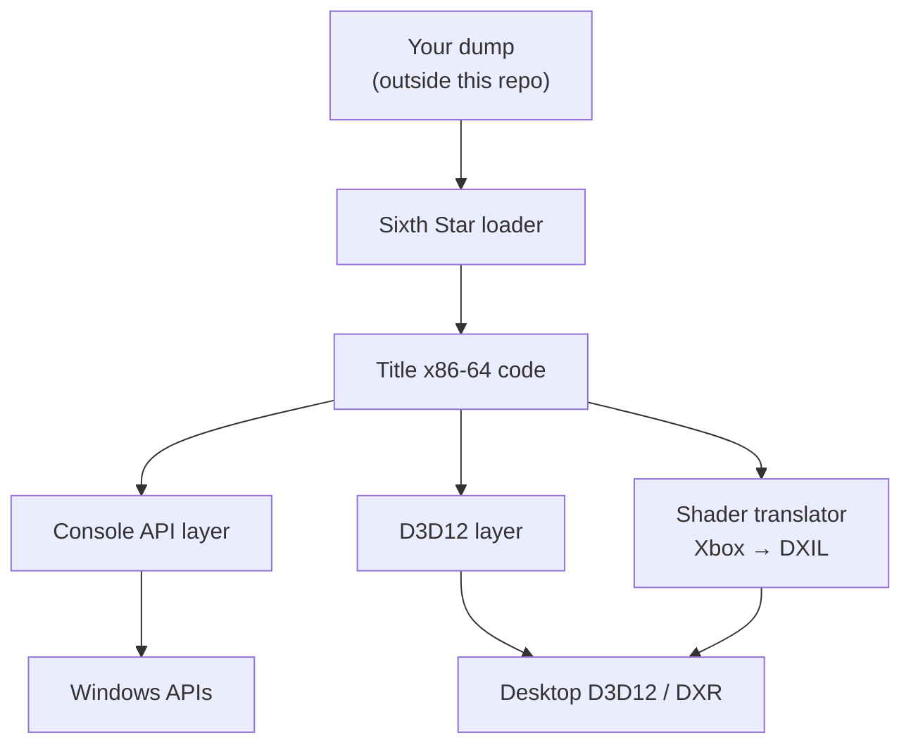

<p align="center">
  
</p>

<p align="center">
  
  
  <a href="https://rustup.rs"></a>
  
  <a href="LICENSE"></a>
  <a href="docs/asset-policy.md"></a>
</p>

<p align="center">
  <b>Run Xbox Series X|S titles on Windows — from your own dump, on your own PC.</b><br>
  <sub>No game files. No downloads. No decryption.</sub>
</p>

---

Sixth Star is a Windows compatibility layer for Xbox Series X|S titles built with the Microsoft GDK. The title's own x86-64 code runs natively on the PC. Sixth Star supplies everything around it:

- the console's system libraries, as high-level replacements;
- the console GPU's shaders, translated to DXIL;
- the console's Direct3D 12 variant, mapped onto desktop Direct3D 12, with DXR for ray tracing.

> [!IMPORTANT]
> **No game is included, and none ever will be.** This repository contains only code and documentation written for it. To run anything you need your own dump of a title you own, made from your own console. Sixth Star never downloads, unlocks or decrypts anything.

> [!WARNING]
> **Experimental.** Expect crashes, missing effects and low frame rates. The design is described in [docs/architecture.md](docs/architecture.md) and [docs/adr/0001-gen2-architecture.md](docs/adr/0001-gen2-architecture.md).

## How it fits together



The title is loaded as a normal Windows PE image. Every import is resolved in this order: Sixth Star's own implementation, an allowed host DLL, a DLL shipped beside the title, or a named stub. Shaders are translated when the title creates a pipeline, from the bytes it passes; the cache makes later runs faster. The full design is in [docs/architecture.md](docs/architecture.md).

## Status

| Area | State | What that means |
|---|---|---|
| Loader and PE mapping | ✅ Implemented | Maps the title, binds imports, handles static TLS, and reports faults as `module+rva`. |
| Console APIs | 🟡 Broad, incomplete | Kernel, files, `xgameruntime`; online services answer as an offline console. Title-specific gaps remain. |
| Shader translation | 🟡 Experimental | Xbox shader containers → DXIL, descriptor tracing, content-addressed cache. Unsupported instructions are listed by the translator. |
| D3D12.X → desktop D3D12 | 🟡 Experimental | Command lists, memory and pipelines; some title-specific behaviour is still missing. |
| DXR | 🟡 Prototype | `apps/dxr-proto` explores ray tracing; not yet a complete title path. |
| Stability and performance | 🔴 Expect issues | Crashes, missing effects and low frame rates are expected. |

Test report: [STATUS.md](STATUS.md) — machine, settings and measured frame rates.

This is a research project, not a finished emulator. Test reports are useful even when they are negative: include the GPU, driver, Windows version and the relevant log lines.

## What you need

| | |
|---|---|
| Windows 10 or 11, x64 | |
| A Direct3D 12 GPU with a current driver | developed on an NVIDIA RTX 3070 |
| [Git](https://git-scm.com/download/win) | to get the code |
| [Rust](https://rustup.rs) | rustup installs the pinned version (1.98.1) by itself |
| [Visual Studio 2022 Build Tools](https://visualstudio.microsoft.com/vs/community/) | workload "Desktop development with C++", including a Windows 10/11 SDK (its `dxil.dll` is used by the shader tests) |
| Your own dump of a GDK title | the package folder, with `MicrosoftGame.config` and the executable |

## Quick start

1. **Get the code.**

   ```powershell
   git clone https://github.com/ihaterockstargames/sixth-star.git
   cd sixth-star
   ```

2. **Create the settings file.** Double-click `run.bat` in the `sixth-star` folder. The first time, it creates `run.config.bat` and stops.

3. **Point it at your dump.** Open `run.config.bat` and fill in two lines:

   ```bat
   set "GAME_DIR=D:\Dumps\MyTitle"
   set "TITLE_EXE=MyTitle.exe"
   ```

   `GAME_DIR` is the folder of your dump: the one with `MicrosoftGame.config`. It must be **outside** the `sixth-star` folder (the launcher refuses otherwise, so your files can never be committed by accident). `TITLE_EXE` is the executable, relative to `GAME_DIR`; it may also be in a subfolder, such as `bin\MyTitle.exe`.

4. **Check the setup without starting anything.**

   ```powershell
   .\run.bat doctor
   ```

5. **Start the title.**

   ```powershell
   .\run.bat
   ```

   The first start builds Sixth Star, which takes a few minutes. Later starts rebuild only what changed. Every run writes a log to `logs\`, and the console window stays open at the end so you can read what happened.

> [!NOTE]
> **Texture tables (BCPack).** Many titles store textures with BCPack compression. Decoding it needs the format's constant tables, which are not our work and so are **not** in this repository. If you have `bcpack-tables.bin`, put it in `crates\victory-formats\src\` (git ignores it there) or next to `target\release\sixth-star.exe`, or set `BCPACK_TABLES` in `run.config.bat` to its path. It is read when the title starts, so no rebuild is needed. Without the tables everything else still works, and the log says when a texture needed them.

## Commands

| Command | What it does |
|---|---|
| `run.bat` | build what changed, then run the title |
| `run.bat nobuild` | run the last build without building |
| `run.bat check` | build, then load and link the title without starting it |
| `run.bat doctor` | check the settings and the tools only |
| `run.bat rebar` | report whether Resizable BAR is active, with the BIOS steps if it is off |
| `run.bat pipelines` | pre-build every pipeline once from `SHADER_ARCHIVE` (saves stutter later) |
| `run.bat selftest` | test the launcher on synthetic files; no title needed |
| `run.bat tests` | the full test suite (`SIXTH_REQUIRE_GPU=1`: GPU tests must run) |
| `run.bat membench`, `vkbench`, `dxr-proto`, `vkrt` | GPU benchmarks; CSV results go to the log folder |
| `run.bat help` | this list |

`run.bat` exits with the title's own exit code, or 1 when a check or the build fails. `NOPAUSE=1` stops it from waiting for a key at the end.

## Project layout

| Path | Role |
|---|---|
| `apps/victory` | command-line front end: `run`, `census`, `inspect`, `translate`, `prebuild` |
| `apps/membench`, `apps/vkbench`, `apps/dxr-proto`, `apps/vkrt` | GPU benchmarks and ray-tracing prototypes |
| `crates/victory-loader` | maps, binds and starts the title image |
| `crates/victory-hle` | console API implementations and host pass-through policy |
| `crates/victory-gpu` | D3D12.X objects, command lists and GPU memory → host D3D12 |
| `crates/victory-shader` | Xbox shader containers → host shaders |
| `crates/victory-formats` | texture layouts, detiling and audio codecs; BCPack planned |
| `crates/victory-pipeline` | converter trait and content-addressed cache |
| `crates/victory-game` | title-specific formats, build identities and hooks |
| `docs` | architecture, ADRs and the asset policy |
| `xtask` | asset-policy check and git hooks |
| `tests/fixtures/hle-probe` | a stand-in "title" (our own code) for loader tests |

Everything except `victory-game` is platform-level and can be tested with any Xbox Series title. The `victory-*` names are internal crate names inherited from the upstream VIctory fork; the product is Sixth Star.

## Settings

[run.config.example.bat](run.config.example.bat) explains each setting. Paths may be absolute or relative: `GAME_DIR`, `CACHE_DIR`, `DATA_DIR` and `LOG_DIR` are relative to the settings file; `TITLE_EXE`, `WORK_DIR`, `MANIFEST` and `SHADER_ARCHIVE` are relative to `GAME_DIR`.

<details>
<summary><b>All settings</b></summary>

| Setting | Default | Meaning |
|---|---|---|
| `GAME_DIR` | (required) | the package root: the console's `G:` drive, where the manifest is |
| `TITLE_EXE` | (required) | the executable |
| `WORK_DIR` | `GAME_DIR` | the title's working directory |
| `MANIFEST` | `GAME_DIR\MicrosoftGame.config` | another manifest |
| `CONSOLE` | `series-x` | `series-s` renders at 720p with FSR and needs `FFX_DIR` |
| `OUTPUT_MODE` | empty | window and swap chain size (`WxH`); empty follows the title's image |
| `RENDER_SCALE` | `1.0` | 0.1 to 2.0: the title renders at `OUTPUT_MODE` (or 1920x1080) times this, and the image is scaled to the window |
| `DISPLAY_MODE` | empty | display size reported to the title outright; wins over `OUTPUT_MODE` x `RENDER_SCALE` |
| `BCPACK_TABLES` | empty | path to `bcpack-tables.bin`; empty uses the copy in `crates\victory-formats\src` or next to `sixth-star.exe` |
| `PRESET` | `safe` | `fast` gives lower latency but can be less stable |
| `SKIP_PIPELINES` / `SKIP_LIST` | none | shader hashes to skip, for a driver that never finishes compiling one |
| `DRED` | `0` | `1`: more detail when the GPU device is removed |
| `LOG_DIR` | `logs` | where logs go |
| `CACHE_DIR` | `%LOCALAPPDATA%\victory\cache` | translated shaders and other caches; grows with play, so put it on a drive with room |
| `DATA_DIR` | `%LOCALAPPDATA%\victory\data` | the title's own data (saves, temporary files); when you change it, move the old folder too |

</details>

To keep the settings somewhere else, set `SIXTH_CONFIG` to that file.

### Resolution scaling

The title is told a display size and picks its render size from it; the runner then scales the image to the window. With nothing set, it is told 1920x1080 and the window follows its image, as before.

| Goal | `OUTPUT_MODE` | `RENDER_SCALE` | The title is told |
|---|---|---|---|
| 1080p native | `1920x1080` | `1.0` | 1920x1080 |
| 720p shown at 1080p | `1920x1080` | `0.6667` | 1280x720 |
| 1080p shown at 1440p | `2560x1440` | `0.75` | 1920x1080 |
| 1080p shown at 4K | `3840x2160` | `0.5` | 1920x1080 |

`run.bat doctor` prints the computed display, output and scale. At start the runner logs `resolution:` and, whenever it changes, `present: source=WxH output=WxH copy|draw|scale`. A title in a borderless fullscreen window keeps its window size; the output is scaled into it.

### How the files are found

The runner keeps four things apart:

- the **executable**;
- the **package root** (`GAME_DIR`, mounted as `G:`, with the manifest);
- the **DLL search path**: the executable's folder first, then the package root;
- the **working directory**.

At startup it prints all four, so a wrong path shows up immediately. The same can be done by hand:

```powershell
target\release\sixth-star.exe run --package D:\Dumps\MyTitle D:\Dumps\MyTitle\bin\MyTitle.exe
```

That loads and links the title but does not start it; add `--execute` to start it. `sixth-star.exe run --help` lists the other options.

## Testing

The test suite runs on synthetic fixtures; no title is needed.

```powershell
.\run.bat doctor
.\run.bat selftest
.\run.bat tests
```

`SIXTH_REQUIRE_GPU=1` makes the GPU tests mandatory instead of skipping them when no suitable adapter is present.

## Troubleshooting

| Symptom | Fix |
|---|---|
| `GAME_DIR is inside the Sixth Star folder` | Move your dump elsewhere. |
| `no cargo on PATH` | Install Rust with rustup, then open a new window. |
| The build fails at linking | Install the C++ build tools and a Windows SDK (see above). |
| Memory grows without end while a shader compiles | Put that shader's hash in `SKIP_PIPELINES`. |
| The GPU device is removed | Run again with `DRED=1` and keep the log. |
| `[gpu upload heap] not measured` in `membench` | The GPU upload-heap benchmark is optional and needs Resizable BAR. Check `run.bat rebar`; if it is off, enable Above 4G Decoding and Re-Size BAR Support in the BIOS and disable CSM. |
| BCPack textures fail or the log says the tables are missing | Put `bcpack-tables.bin` in `crates\victory-formats\src`, next to `sixth-star.exe`, or set `BCPACK_TABLES` to its path. |

Every run writes a log to `logs\`. Read the first error, not the last line: later failures are often consequences of the first one.

## Contributing

Issues and pull requests are welcome. Read [CONTRIBUTING.md](CONTRIBUTING.md) before you start.

> [!CAUTION]
> Never attach or commit game files, dumps, extracted assets or anything else you did not write. The [asset policy](docs/asset-policy.md) explains the rule. `cargo xtask policy` checks it, and after `cargo xtask install-hooks` git runs that check on every commit.

## Credits and licence

Sixth Star is a fork of [VIctory](https://github.com/Marvisak/VIctory) by Marvisak, through the forks of [fxceless](https://github.com/fxceless) and KLBF Lab. It keeps their copyright notices and, like them, is licensed under the [GPL-3.0](LICENSE). Ideas from other open-source projects (shadPS4, GPURT, vkd3d-proton, D3D12 Memory Allocator and others) are credited where they are used.

Sixth Star is not affiliated with or endorsed by Microsoft or any game publisher. Product names are used only to say what this works with; they belong to their owners.

---

<p align="center"><sub>Built for people who want to understand the machine they own.</sub></p>
